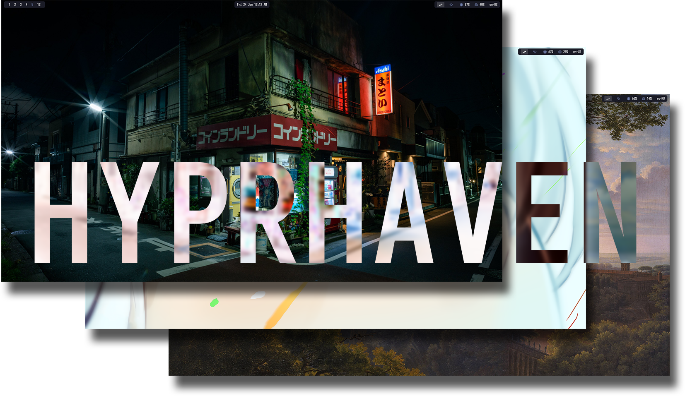

<h1 align="center">Hyprhaven</h1>

Tired of your own wallpaper collection? Hyprhaven has you covered

## About

Hyprhaven fetches a random wallpaper from [wallhaven.cc](https://wallhaven.cc/) and sets it as your desktop background. It keeps running and rotates the wallpaper on a configurable interval.

It works on Windows, macOS, and Linux using the platform-native wallpaper backends in `internal/wallpaper`.

## Install

### Windows

1. Either build or download latest version from release

2. Press <kbd>Ctrl</kbd> + <kbd>R</kbd> and type `shell:startup` to open folder with apps that will launch on user login

3. Copy `hyprhaven.exe` to the startup folder

4. Run executable file / Reboot

_On the first run the script must be run with elevated privileges to set the registry keys for the lock screen._

### macOS

1. Build the binary:

    `make build-darwin`

2. Run it:

    `./hyprhaven`

3. No extra permissions are required. Hyprhaven uses the native `NSWorkspace` API, which works on macOS 15 and later.

To start it automatically at login, add a `launchd` agent or simply add the binary to **System Settings → General → Login Items**.

### Linux

Build with `make build-linux` and run it inside a supported desktop session (GNOME, KDE, XFCE, etc.). Wayland compositors need `swaybg`; i3 needs `feh`.

## Build

1. Run makefile

    `make`

_if building using WSL you can run `make build-windows` for the program to run in tray or `make build-windows-debug` for the program to run in CMD_

`make build-darwin` builds for the host architecture. Use `make build-darwin-arm64` or `make build-darwin-amd64` for an explicit target.

## Configuration

These are all optional parameters

The script can be customized using the following command-line flags:

| Flag       | Type     | Default Value | Description                                                                                                          |
| ---------- | -------- | ------------- | -------------------------------------------------------------------------------------------------------------------- |
| `-t`       | `int`    | `15`          | The time interval (in minutes) to wait before setting the wallpaper.                                                 |
| `-pq`      | `int`    | `5`           | The maximum search page to randomly pick a wallpaper from.                                                           |
| `-s`       | `string` | `favorites`   | The sorting criterion for the wallpapers.                                                                            |
| `-c`       | `string` | `111`         | The category IDs to filter wallpapers.                                                                               |
| `-q`       | `string` | `""`          | The search query for wallpaper search.                                                                               |
| `-p`       | `string` | `100`         | The purity level of the wallpapers.                                                                                  |
| `-apikey`  | `string` | `""`          | API key to make user specific/NSFW requests.                                                                         |
| `-sz`      | `string` | `1920x1080`   | The minimum resolution for the wallpaper.                                                                            |
| `-r`       | `string` | `landscape`   | The ratio for the wallpaper (accepts values like `21x9` as well as `portrait` or `landscape` for tall/wide pictures) |
| `-id`      | `string` | `""`          | IDs list to select wallpaper from (like `"45p3m5,1p6d79"`)                                                           |
| `-once`    | `bool`   | `false`       | Set one wallpaper and exit. Useful for testing.                                                                      |

All possible values can be referenced from [wallhaven API](https://wallhaven.cc/help/api).

Without `-apikey`, NSFW purity is automatically disabled.

Downloaded wallpapers are kept in a persistent per-user directory:

- macOS: `~/Library/Application Support/hyprhaven/wallpapers`
- Windows: `%LocalAppData%\hyprhaven\wallpapers`
- Linux: `$XDG_DATA_HOME/hyprhaven/wallpapers` (default `~/.local/share/hyprhaven/wallpapers`)

Set `HYPRHAVEN_DATA_DIR` to override it.
